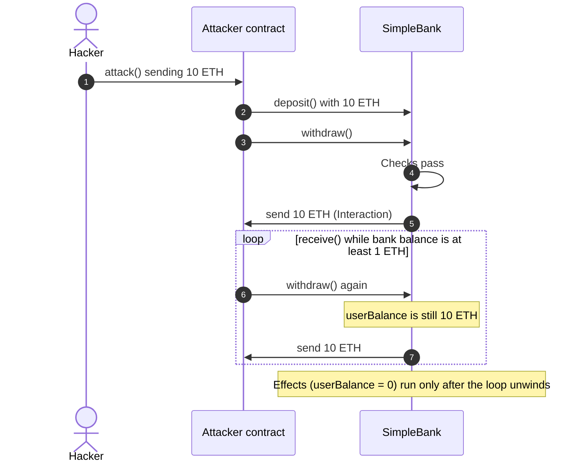
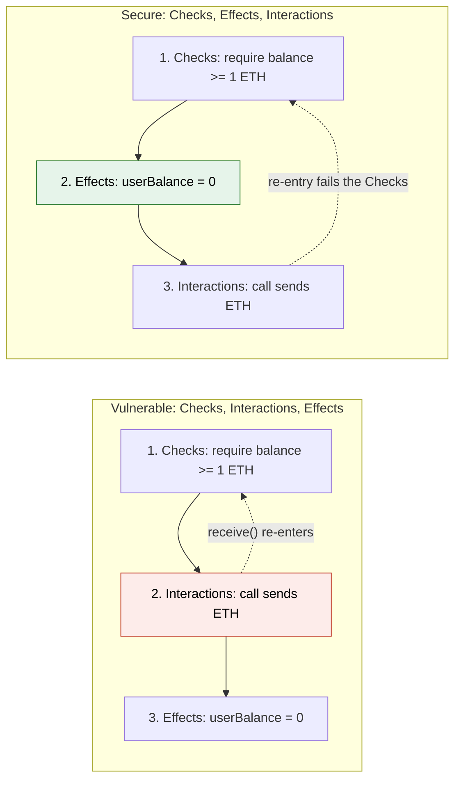

# Reentrancy Attack (Foundry)

[](https://github.com/alchzamb/reentrancy-attack-foundry/actions/workflows/test.yml)

A Foundry test suite that proves a **reentrancy attack** and its fix. A vulnerable `SimpleBank` is drained by an `Attacker` contract because `withdraw()` sends ETH **before** updating the user's balance. The patched `SimpleBankSecure` follows the **Checks-Effects-Interactions (CEI)** pattern and blocks the same attack.

> **Educational purpose only.** `SimpleBank` is intentionally vulnerable. Never deploy it to a real network with real funds.

This is the Foundry version of my [Remix reentrancy demo](https://github.com/alchzamb/reentrancy-attack): same scenario, now with automated tests, a patched contract side by side, and CI.

---

## Table of contents

- [Overview](#overview)
- [Contracts](#contracts)
- [Why it is vulnerable](#why-it-is-vulnerable)
- [Attack flow](#attack-flow)
- [Step-by-step trace](#step-by-step-trace)
- [Vulnerable vs. secure order (CEI)](#vulnerable-vs-secure-order-cei)
- [The fix](#the-fix)
- [Tests](#tests)
- [Project structure](#project-structure)
- [Getting started](#getting-started)
- [Key learnings](#key-learnings)
- [Possible improvements](#possible-improvements)
- [Related work](#related-work)
- [Author](#author)
- [License](#license)

---

## Overview

Reentrancy happens when a contract makes an external call to an untrusted address **before** it finishes updating its own state. The receiver can use that call to jump back into the original function while the state is still outdated, and repeat the action until the funds run out.

## Contracts

| Contract | File | Role |
| --- | --- | --- |
| `SimpleBank` | `src/SimpleBank.sol` | Victim. Deposit at least 1 ETH, withdraw later. Sends ETH before updating the balance. |
| `SimpleBankSecure` | `src/SimpleBankSecure.sol` | Patched version. Same API, but follows CEI. |
| `Attacker` | `src/Attacker.sol` | Malicious contract. Deposits once, then abuses `receive()` to call `withdraw()` repeatedly. Works against any bank that implements `IBank`. |

## Why it is vulnerable

The order of operations inside `SimpleBank.withdraw()` is the problem:

```solidity
function withdraw() public {
    // 1. Checks
    require(userBalance[msg.sender] >= 1 ether, "User has not enough balance");
    require(address(this).balance > 0, "Bank is rekt");

    // 3. Interactions (executed too early)
    (bool success,) = msg.sender.call{value: userBalance[msg.sender]}("");
    require(success, "Fail");

    // 2. Effects (executed too late)
    userBalance[msg.sender] = 0;
}
```

When `call` sends ETH to the `Attacker`, its `receive()` function runs automatically. At that moment `userBalance[attacker]` is **still 10 ETH**, so the next `withdraw()` passes every check again, and so does the one after it.

## Attack flow



## Step-by-step trace

Scenario used in the tests: the bank holds **40 ETH** from honest users (Alice and Bob, 20 ETH each) and the attacker calls `attack()` with **10 ETH**.

| Step | Action | Bank balance after | Attacker received |
| --- | --- | --- | --- |
| 0 | Initial state | 40 ETH | 0 ETH |
| 1 | `attack()` calls `deposit()` with 10 ETH | 50 ETH | 0 ETH |
| 2 | `withdraw()` #1: checks pass, sends 10 ETH | 40 ETH | 10 ETH |
| 3 | `receive()` re-enters, `withdraw()` #2 | 30 ETH | 20 ETH |
| 4 | `receive()` re-enters, `withdraw()` #3 | 20 ETH | 30 ETH |
| 5 | `receive()` re-enters, `withdraw()` #4 | 10 ETH | 40 ETH |
| 6 | `receive()` re-enters, `withdraw()` #5 | 0 ETH | 50 ETH |
| 7 | Bank balance is below 1 ETH, so `receive()` stops. The pending `userBalance = 0` lines run while the stack unwinds. | 0 ETH | **50 ETH** |

The attacker put in 10 ETH and walked away with 50 ETH: their own deposit plus the 40 ETH that belonged to other users.

## Vulnerable vs. secure order (CEI)



The CEI pattern says every function should follow this order:

1. **Checks**: validate inputs and conditions (`require`).
2. **Effects**: update the contract's own state.
3. **Interactions**: only then talk to external addresses.

## The fix

`SimpleBankSecure.withdraw()` reads the amount into a local variable and zeroes the balance **before** sending the ETH:

```solidity
function withdraw() public {
    // 1. Checks
    uint256 amount = userBalance[msg.sender];
    require(amount >= 1 ether, "User has not enough balance");
    require(address(this).balance > 0, "Bank is rekt");

    // 2. Effects
    userBalance[msg.sender] = 0;

    // 3. Interactions
    (bool success,) = msg.sender.call{value: amount}("");
    require(success, "Fail");
}
```

If the attacker re-enters from `receive()`, `userBalance` is already 0 and the first `require` fails. The inner `withdraw()` reverts, so the attacker's `receive()` reverts, the outer low-level `call` returns `false`, and `require(success, "Fail")` reverts the whole `attack()` transaction. No funds leave the bank.

## Tests

All tests live in `test/Reentrancy.t.sol`. The `setUp()` deploys both banks and an `Attacker` pointed at each one, and gives the bank 40 ETH of honest deposits (Alice and Bob, 20 ETH each).

| Test | What it proves |
| --- | --- |
| `test_HonestUserCanWithdraw` | A normal user can deposit and withdraw on the vulnerable bank. |
| `test_DepositBelowMinimumReverts` | Deposits under 1 ETH revert with `"Minimum deposit is 1 ETH"`. |
| `test_AttackDrainsVulnerableBank` | The attack leaves the bank at 0 ETH and the `Attacker` with 50 ETH. |
| `test_SecureBankBlocksReentrancy` | The same attack on `SimpleBankSecure` reverts with `"Fail"` and the bank keeps its 40 ETH. |
| `testFuzz_SecureDepositAndWithdraw` | Fuzz (256 runs, 1 to 1000 ETH): deposit then withdraw returns the full amount and leaves the balance at 0. |

```text
Ran 5 tests for test/Reentrancy.t.sol:ReentrancyTest
[PASS] testFuzz_SecureDepositAndWithdraw(uint256) (runs: 256, μ: 57525, ~: 57780)
[PASS] test_AttackDrainsVulnerableBank() (gas: 74002)
[PASS] test_DepositBelowMinimumReverts() (gas: 19268)
[PASS] test_HonestUserCanWithdraw() (gas: 45404)
[PASS] test_SecureBankBlocksReentrancy() (gas: 64534)
Suite result: ok. 5 passed; 0 failed; 0 skipped
```

To watch the re-entrant calls stack up one by one, run the attack test with maximum verbosity:

```bash
forge test --match-test test_AttackDrainsVulnerableBank -vvvv
```

## Project structure

```text
.
├── src/
│   ├── Attacker.sol          # malicious contract + IBank interface
│   ├── SimpleBank.sol        # vulnerable bank
│   └── SimpleBankSecure.sol  # CEI-compliant bank
├── test/
│   └── Reentrancy.t.sol      # unit + fuzz tests
├── lib/                      # forge-std, openzeppelin-contracts (git submodules)
├── foundry.toml
└── .github/workflows/test.yml
```

## Getting started

Requirements: [Foundry](https://book.getfoundry.sh/getting-started/installation).

```bash
git clone --recurse-submodules https://github.com/alchzamb/reentrancy-attack-foundry.git
cd reentrancy-attack-foundry

forge build
forge test
```

If you already cloned without `--recurse-submodules`, run `git submodule update --init --recursive`.

CI runs `forge fmt --check`, `forge build` and `forge test` on every push.

## Key learnings

- External calls hand control to untrusted code. Anything that runs inside the receiver's `receive()` or `fallback()` is outside your control.
- State must be updated **before** any external call: **Checks, Effects, Interactions**.
- A low-level `call` forwards all available gas, which is what makes the re-entry possible.
- The attack amount matters. With 10 ETH against a 40 ETH bank the loop ends exactly at 0. If the deposit does not divide the bank's total balance, the last re-entrant `withdraw()` tries to send more ETH than is left, fails, and reverts the whole attack.
- Reentrancy tests need a malicious contract. One `Attacker` written against an interface can test the vulnerable and the patched bank with the same code.

## Possible improvements

- Add a third variant using OpenZeppelin's `ReentrancyGuard` (`nonReentrant`) as defense in depth. The library is already installed under `lib/`.
- Add an invariant test: the bank's ETH balance must always equal the sum of all user balances.
- Add events on `deposit()` and `withdraw()`.
- Replace the push payment with a pull-payment (withdraw) pattern.

## Related work

- [reentrancy-attack](https://github.com/alchzamb/reentrancy-attack): the original Remix version of this demo, with screenshots of the attack.
- [cryptobank-foundry](https://github.com/alchzamb/cryptobank-foundry): reentrancy attack/defense demo with Vulnerable and Safe contracts.

## Author

Based on an educational exercise from the Blockchain Accelerator program. Foundry tests, documentation, and diagrams by Alex Zambrano.

## License

MIT
